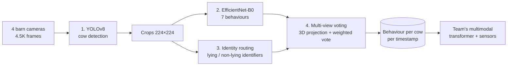

<h1 align="center">🐄 MmCows Visual: Cattle Behaviour & Identity from Barn Cameras</h1>
<p align="center"><b>Python · PyTorch · YOLOv8 · EfficientNet · ViT · multi-view geometry · MLflow</b></p>

---

## Problem

Farmers need to know what each cow is doing (feeding, lying, walking, drinking…) to catch illness and welfare issues early, but watching barn video by hand does not scale. The hard part is not finding cows in an image; it is telling 16 nearly identical Holstein cows apart across 4 cameras.

## Solution

A four-stage vision pipeline (detect → classify behaviour → identify the cow → fuse the 4 camera views in 3D), evaluated with honest temporal cross-validation, plus an experiment that merges detection and identification into one YOLOv8 model.

## Architecture



## Overview

Visual pipeline for recognising the behaviour and identity of 16 Holstein cows from four 4.5K barn cameras. Part of a 4-person INSAT engineering project extending the MmCows benchmark (defended June 2026); this repo is the **vision branch** (my contribution).

**Key result:** cow detection is essentially solved (mAP@0.5 = 0.99), but telling 16 near-identical cows apart is not. Under honest temporal cross-validation, joint detection + identification drops to mAP@0.5 = 0.48, a 51% gap that a naive split completely hides.

## Results at a glance

| Experiment | Metric | Result |
| --- | --- | --- |
| Binary cow detector (YOLOv8n) | mAP@0.5 / mAP@0.5:0.95 (test) | 0.991 / 0.789 |
| 17-class detection + identification (YOLOv8n), naive split | mAP@0.5 | 0.987 |
| Same model, 5-fold temporal CV | mAP@0.5 | **0.481 ± 0.075** (−51%) |
| Baseline pipeline, single-view (RGBs) | Behaviour macro F1 | 0.554 |
| Baseline pipeline, multi-view voting (RGBm) | Behaviour macro F1 | **0.632** |

The multi-view behaviour predictions feed the team's Multimodal Bottleneck Transformer, which reaches 0.749 ± 0.014 macro F1 when fused with sensor data.

## 1. Baseline replication: four-stage pipeline

Reproduces the reference MmCows visual pipeline and evaluates it with the official 5-fold temporal splits (lighting-based periods, 3:1:1 train/val/test).

| Stage | Model | Result |
| --- | --- | --- |
| 1. Detection | YOLOv8, binary (cow), ~20k annotated images | mAP@0.5:0.95 = 0.729 ± 0.014 |
| 2. Behaviour classification | EfficientNet-B0 on 224×224 crops, 7 classes | macro F1 = 0.678 ± 0.025 |
| 3. Identity routing | Two EfficientNet-B0 identifiers (lying / non-lying) | macro F1 = 0.540 / 0.942 |
| 4. Multi-view voting | Project box centres to 3D with camera projection matrices, drop outlier views, vote weighted by box width | RGBs 0.554 → RGBm 0.632 |

## 2. Extension: joint detection + identification with YOLOv8

Instead of detecting, then identifying in separate models, a single YOLOv8n is trained with 17 classes (one per cow). Because identity is the class index, the same cow seen by two cameras already carries the same label, so no cross-camera matching is needed.

**Training setup:** YOLOv8-nano (3M params) · 640×640 · batch 32 · AdamW · mixed precision · up to 50 epochs (patience 10) · NVIDIA RTX 5060 Ti 8 GB.

**Naive split vs. temporal cross-validation:**

| Metric | 70/15/15 split | 5-fold temporal CV | Gap |
| --- | --- | --- | --- |
| mAP@0.5 | 0.987 | 0.481 ± 0.075 | −51% |
| mAP@0.5:0.95 | 0.779 | 0.325 ± 0.054 | −58% |
| Precision | 0.966 | 0.520 ± 0.074 | −46% |
| Recall | 0.951 | 0.464 ± 0.061 | −51% |

With nearby timestamps in train and test, the model memorises cow positions and postures. Testing on a different time-of-day period removes that shortcut.

**Per-fold mAP@0.5** ranges from 0.397 (early morning, low artificial light) to 0.575 (midday, natural light): illumination is the main driver of variance. All folds early-stop at epochs 30–35, suggesting YOLOv8n lacks capacity for fine-grained 16-way identification.

## 3. Multi-camera fusion experiments

Each camera runs YOLOv8 → crop → ViT-Small behaviour classifier; predictions are fused by voting weighted on detection confidence and box area.

| Behaviour | Single-view | Weighted voting |
| --- | --- | --- |
| Feeding head-down | 0.883 ± 0.027 | 0.890 ± 0.025 |
| Lying | 0.815 ± 0.030 | 0.830 ± 0.028 |
| Feeding head-up | 0.805 ± 0.046 | 0.821 ± 0.042 |
| Standing | 0.741 ± 0.044 | 0.722 ± 0.048 |
| Walking | 0.578 ± 0.172 | 0.594 ± 0.160 |
| Licking | 0.478 ± 0.154 | 0.452 ± 0.165 |
| Drinking | 0.127 ± 0.053 | 0.115 ± 0.058 |
| **Mean macro F1** | **0.632 ± 0.075** | **0.632 ± 0.078** |

A second experiment reprojected boxes between cameras and intersected them with native detections to correct crops geometrically. It gave no consistent improvement: imprecise reprojections produced narrow crops that lost useful content.

## Findings

1. **Identification is the bottleneck**, not detection or behaviour classification. Binary detection reaches 0.99 mAP@0.5; 16-way identity drops it to 0.48.
2. **Temporal cross-validation is mandatory** for livestock video. A random-like split overestimated mAP@0.5 by 51%.
3. **Lighting drives fold variance** (0.397 → 0.575 mAP@0.5).
4. **Smarter voting can't fix weak per-frame identity.** Weighted and geometric fusion kept F1 flat at 0.632.

## Next steps

- Larger backbones (YOLOv8-s/m) and a dedicated re-ID head trained with triplet or contrastive loss
- Coat-pattern descriptors as an interpretable identity cue
- Temporal aggregation across frames and views, plus photometric augmentation for lighting robustness

## Repository structure

```
notebooks/        exploration and experiments
scripts/          training, inference, and evaluation scripts
shared/           common utilities
runs/             training runs (YOLO)
outputs/results/  evaluation outputs
setup_project.sh  environment setup
```

## How to run

The MmCows dataset is not included (too large for git); download it from the [official repo](https://github.com/neis-lab/mmcows).

```bash
git clone https://github.com/OussemaBouchaala/mmcows-visual.git
cd mmcows-visual
bash setup_project.sh                 # creates folders and the virtual env
pip install -r requirements.txt

python scripts/a1_build_index.py      # index images + labels from the 4 cameras
python scripts/a2_yolo_binary.py      # write YOLO train/val/test splits + dataset yaml
```

Then open the notebooks in order (`notebooks/I3_1` → `I3_4`, then `detect/` and `tracking/`) for training, identification and tracking experiments. Training runs are logged with MLflow under `runs/`.

No GPU or dataset? The results tables above summarise every experiment.

## Dataset

[MmCows](https://github.com/neis-lab/mmcows) (CC BY-NC-SA 4.0): H. Vu, O. Prabhune, U. Raskar, D. Panditharatne, H. Chung, C. Choi, Y. Kim, "MmCows: A Multimodal Dataset for Dairy Cattle Monitoring," NeurIPS 2024 Datasets and Benchmarks Track.

## Team

INSAT, academic year 2025–2026, supervised by Pr. Rabaa Youssef.
Oussema Bouchaala (visual pipeline) · Hazem Ben Alaya (sensor pipeline) · Iheb Gafsi (multimodal fusion) · Haythem Krid (ML server & MLOps)
